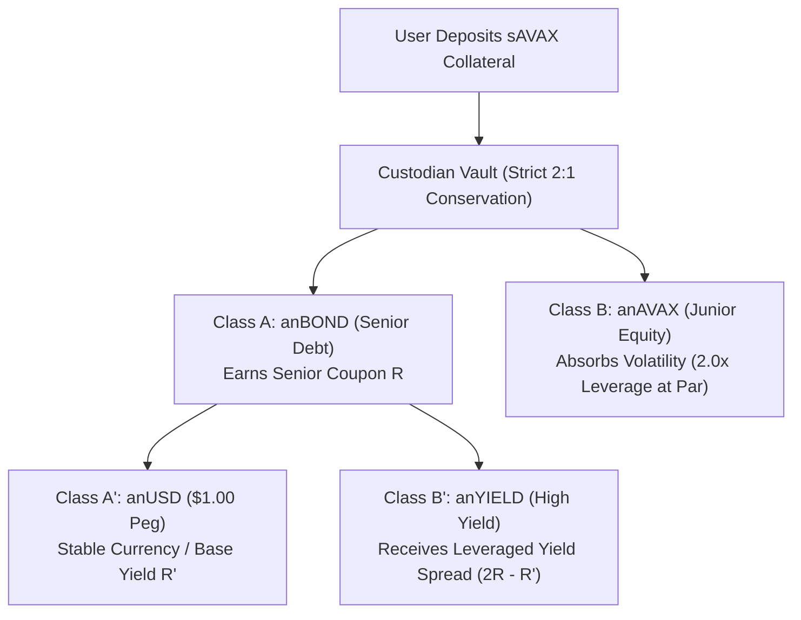
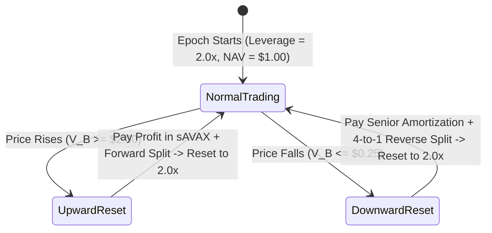
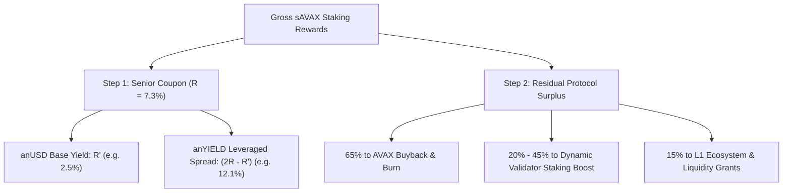
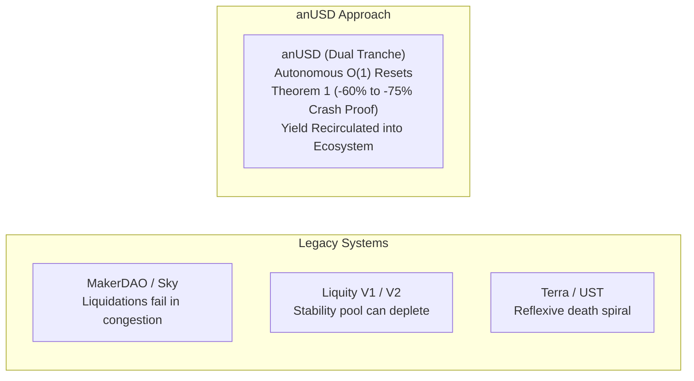

# Technical Due Diligence Memorandum: Avalanche Native USD (anUSD)

**To:** Hansen Niu & the BENQI Protocol & Risk Engineering Team  
**From:** Bonding Curves Research Group (BCRG)  
**Date:** November 10, 2026  
**Subject:** Technical Responses on anUSD Architecture, sAVAX Yield Waterfall, Downside Risk, and Open Research Frontiers  
**Document Status:** Working Draft for BENQI Review (Provisional Baselines & Discussion Points)

---

## Overview for Readers

This document answers the four questions asked by Hansen regarding the **anUSD (Avalanche Native USD)** proposal:

1. **How the Mechanism & 2× Leverage Work:** Mint and redeem rules, collateral ratios, and how $\text{anAVAX}$ stays at $2\times$ leverage as price changes.
2. **How sAVAX Staking Yield is Divided:** The exact path of staking rewards between $\text{anBOND}$, $\text{anUSD}$, $\text{anYIELD}$, $\text{anAVAX}$, and ecosystem buybacks.
3. **What Happens if AVAX Drops 50% to 60% in a Month:** How the system protects holders during slow bear markets and sudden flash crashes.
4. **How anUSD Compares to Other Stablecoins:** A clear comparison against MakerDAO, Liquity, and Terra (with notes on research boundaries).
5. **Open Research Questions for BENQI & BCRG:** Clear statements on what we have *not* modeled yet—specifically the real-world link between $sAVAX$ and $AVAX$, and full parameter optimization (PSUU).



---

## 1. Status of Our Claims (What is Proven vs. What is Provisional)

To be completely honest and transparent about our research:

* **Mathematically Proven (Frozen):**
  * The dual-tranche math (Ingersoll, 1976) and strict value conservation.
  * The 2-to-1 mint/burn rule between Token A and (anUSD + anYIELD).
  * The automatic $O(1)$ reset rules at upper and lower boundaries.
  * **Theorem 1 Crash Bound:** Analytical proof that anUSD survives up to a $-60\%$ flash crash from the lower boundary and $-75\%$ from par without losing value.
* **Tested by Simulation (Audited Baseline):**
  * cadCAD simulation on 2,140 days of Avalanche price data ($0.00\%$ haircut across 500 jump-diffusion paths).
* **Provisional / NOT Yet Modeled (Needs Joint Work with BENQI):**
  * **$sAVAX \leftrightarrow AVAX$ Market Relationship:** We assumed $sAVAX$ always trades at its theoretical value. In the real world, $sAVAX$ can trade at a discount on DEXs during panic, and unstaking takes 14 days. This dynamic has **not** been modeled yet.
  * **Final Parameter Selection (PSUU):** The exact numbers ($H_u = \$2.00$, $H_d = \$0.25$, $R = 7.3\%$) are initial starting examples, **not** final production numbers. Full Parameter Selection Under Uncertainty (PSUU) has **not** been completed yet.
  * **Scope of Prior Research:** Our past deep-dive post-mortems examined **MakerDAO/Sky, Terra, and Liquity**. We have **not** conducted modeling or simulations on **Ethena (USDe)**.

---

## 2. Mechanism & 2× Leverage (Question 1)

> **Hansen's Question:** *"could you expand on the mechanism? keen to learn more about the mint redeem rules, collateral ratio etc etc and how anAVAX is kept at 2x lev as price moves"*

### 2.1 The Core Idea: Two Classes of Tokens
When users deposit $sAVAX$ into the protocol, the contract creates two complementary tokens:

1. **Senior Tranche ($\text{anBOND}$ / Class A):**  
   A conservative claim that aims for principal protection and earns a fixed annual coupon $R$ ($R = 7.3\%$ in our initial example):
   $$V_A(t) = 1 + R \cdot v_t$$
   *(where $v_t$ is the time elapsed since the last reset).*

2. **Junior Tranche ($\text{anAVAX}$ / Class B):**  
   An equity claim that absorbs the price movement of the underlying AVAX:
   $$V_B(t) = 2 \cdot S_t - V_A(t)$$
   *(where $S_t$ is the price index of AVAX relative to epoch start).*

### 2.2 Secondary Split: Creating the anUSD Dollar
Class A earns interest over time, so its value increases ($1.01, 1.02...$). To make a true $\$1.00$ stablecoin, Class A is split into two secondary tokens:

* **$\text{anUSD}$ (Class A$'$):** Fixed at $\$1.00$ par value. It acts as clean cash and can earn a modest money-market yield ($R'$, e.g., $2.5\%$).
* **$\text{anYIELD}$ (Class B$'$):** Takes the remaining coupon spread $(2R - R')$. When $R = 7.3\%$ and $R' = 2.5\%$, anYIELD earns $(2 \times 7.3\% - 2.5\%) = 12.1\%$ APY.

> [!IMPORTANT]
> **Strict 2-to-1 Mint and Burn Rule:**  
> To prevent anyone from minting unbacked tokens, the contract strictly requires:
> * **To Mint:** You must burn exactly **2 units of Token A** to receive **1 unit of anUSD + 1 unit of anYIELD**.
> * **To Redeem:** You must combine and burn **1 anUSD + 1 anYIELD** to get back **2 units of Token A**.

### 2.3 How anAVAX Stays at 2× Leverage
At the start of an epoch:
* For every $\$2.00$ of deposited collateral, the protocol owes $\$1.00$ to Senior Class A, leaving $\$1.00$ for Junior Class B ($\text{anAVAX}$).
* Because $\$1.00$ of anAVAX controls $\$2.00$ of collateral, its leverage is exactly:
  $$\text{Leverage} = \frac{\text{Total Collateral}}{\text{anAVAX Value}} = \frac{\$2.00}{\$1.00} = \mathbf{2.0\times}$$

#### What Happens When AVAX Price Moves?
* **If AVAX price goes UP:** anAVAX value grows faster than the collateral. For example, if AVAX rises $+50\%$, anAVAX reaches $\$2.00$. Leverage naturally drops from $2.0\times$ down toward $1.5\times$.
* **If AVAX price goes DOWN:** anAVAX absorbs the loss. If AVAX falls $-37.5\%$, anAVAX drops to $\$0.25$. Leverage naturally rises from $2.0\times$ up toward $5.0\times$.

### 2.4 Autonomous Resets (No Debt Auctions)
Instead of liquidating individual users with auction bots (like MakerDAO), the protocol uses **global state resets** at two automated trigger points:



1. **Upward Reset (Triggered when anAVAX $\ge \$2.00$):**
   * **Harvest Profit:** anAVAX holders receive their extra gains in $sAVAX$ collateral directly to their wallets.
   * **Forward Split:** The number of shares is doubled ($2\text{-for-}1$), dropping the price of each token back to $\$1.00$.
   * **Result:** Leverage is safely reset back to exactly $2.0\times$.

2. **Downward Reset (Triggered when anAVAX $\le \$0.25$):**
   * **Senior Amortization:** The contract automatically pays Senior holders $\$0.75$ of their $\$1.00$ value directly in $sAVAX$ collateral. This immediately cuts protocol debt by $75\%$.
   * **Reverse Split (Consolidation):** The remaining shares are merged 4-to-1.
   * **Result:** Every remaining token is once again worth $\$1.00$, backed by $400\%$ collateral coverage, and leverage resets back to $2.0\times$.

---

## 3. Yield Waterfall & Token Distribution (Question 2)

> **Hansen's Question:** *"how is the sAVAX staking yield divided between anBOND, anYIELD, anAVAX etc.?"*

Deposited collateral is $sAVAX$, which generates native staking rewards (currently around $4.5\% - 5.5\%$ APY). Because each pair holds $\$2.00$ of $sAVAX$ for every $\$1.00$ of senior debt, the system collects double the staking yield per senior dollar.

Here is the exact distribution:



### Summary of Each Token's Return

| Token | Role | Expected Yield / Return | Where the Return Comes From |
| :--- | :--- | :--- | :--- |
| **$\text{anUSD}$** | Cash Stablecoin | Base yield: $R' \approx 0.0\% - 2.5\%$ p.a. | Paid from the senior coupon allocation. |
| **$\text{anYIELD}$** | High-Yield Tranche | Leveraged yield: $(2R - R') \approx 12\% - 14\%$ p.a. | Concentrates the remaining senior coupon. |
| **$\text{anBOND}$** | Parent Senior Claim | Base senior rate: $R \approx 7.3\%$ p.a. | Contractual fixed claim on $sAVAX$ staking. |
| **$\text{anAVAX}$** | Leveraged Token | $2\times$ AVAX price upside (zero staking yield) | Trading gains + profit payouts at upward reset. |

### Example Surplus Scheme: ACP-67 Community Proposal (One Possible Option)
The distribution of protocol surplus (fees and staking yield beyond coupon obligations) shown below is strictly an illustrative reference. It is based directly on an informal community suggestion made in an Avalanche Community Proposal GitHub discussion comment (ACP-67 / Discussion #293):
* **65% Buyback & Burn:** Purchases AVAX on open market DEXs and burns it.
* **20% to 45% Validator Boost:** Automatically increases rewards to Avalanche validators if AVAX price drops below its 90-day moving average.
* **15% L1 Grants:** Funds growth grants on Avalanche Sovereign L1s.

> [!IMPORTANT]
> **Not a Fixed or Exclusive Scheme:**  
> This specific breakdown is an example of an ecosystem flywheel that the Avalanche Foundation or community might be interested in. **For BENQI, this is not a fixed or exclusive distribution.** A completely different surplus distribution model can be designed around BENQI's specific requirements, commercial goals, and DAO priorities (for example: directing value to QI stakers, sAVAX liquidity pools, protocol-owned reserves, or custom incentive mechanisms). We consider this design space entirely open.

---

## 4. Extreme Downside: 50% to 60% Monthly AVAX Crash (Question 3)

> **Hansen's Question:** *"what happens to each token if AVAX falls 50-60% within a month?"*

To answer this honestly, we must clearly separate **what the smart contract code is programmed to do**, **what we have actually modeled**, and **what has not yet been modeled**.

### 4.1 How the Smart Contract Code is Programmed to Behave
In code, the protocol does not use debt auctions. Instead, it relies on deterministic state transitions:

1. **Absorption by Junior Equity:** As AVAX price drops, $\text{anAVAX}$ (Class B) absorbs $100\%$ of the loss until its value reaches $H_d = \$0.25$ (a $-37.5\%$ drop from par). During this phase, $\text{anUSD}$ stays at $\$1.00$.
2. **Automated Downward Reset:** When anAVAX hits $\$0.25$, the contract triggers an automated reset:
   * **Senior Cash Payout:** Senior holders receive $\$0.75$ of their value paid out directly in physical $sAVAX$ collateral.
   * **Consolidation (Reverse Split):** The remaining shares are merged 4-to-1.
   * **Recapitalization:** Each remaining share is restored to $\$1.00$ par value, backed by $400\%$ collateral coverage, and leverage resets back to $2.0\times$.
3. **Subsequent Declines:** If the price continues dropping, the recapitalized vault absorbs the next drop down to the new $\$0.25$ boundary, triggering another reset if hit.

### 4.2 What We Have Actually Modeled
* ** cadCAD Jump-Diffusion Simulation:** We modeled 500 stochastic paths over a 365-day horizon using Kou jump-diffusion parameters calibrated to 2,140 days of historical Avalanche C-Chain data ($\sigma = 89.15\%$, jump intensity $\lambda = 15.00/\text{yr}$, negative jump probability $p = 59.55\%$). In those simulations, automated resets fired at $H_d$ and resulted in **$0.00\%$ senior haircut** across the 500 paths, averaging $3.71\text{ resets/year}$.
* **Theorem 1 Analytical Crash Bound:** We derived a closed-form mathematical proof showing that anUSD can absorb an instantaneous flash crash of **up to $-75.0\%$ from par** and **$-60.0\%$ from the lower boundary ($H_d = 0.25$)** with zero principal loss:

$$\text{Max Safe Instant Drop from Par } (S=1.0) = \mathbf{-75.0\%}$$
$$\text{Max Safe Instant Drop from Barrier } (H_d = 0.25) = \mathbf{-60.0\%}$$

```
Par State (S = 1.0) ──[ Safe Flash Drop up to -75% ]──> anUSD Still at $1.00 Par
Barrier State (H_d = 0.25) ──[ Safe Flash Drop up to -60% ]──> anUSD Still at $1.00 Par
```

### 4.3 What We Have NOT Modeled (Explicit Limitations)
To avoid overclaiming, we want to be explicit about what has **not** been modeled:
* We have **not** simulated a specific, deterministic scenario of AVAX dropping $-50\%$ to $-60\%$ over exactly 30 days with dynamic actor behavior.
* We have **not** modeled how real market participants react during consecutive resets (e.g. whether users immediately sell their amortized $sAVAX$ on DEXs, creating secondary market price pressure).
* We have **not** modeled physical unstaking queues or liquidity delays if multiple resets happen in rapid succession.

*Summary:* The smart contract arithmetic and single-jump boundaries are mathematically verified, but dynamic multi-week market behavior with real trader reactions under an extended bear run remains an open area for modeling.

---

## 5. Comparison to Previous Designs (Question 4)

> **Hansen's Question:** *"generally speaking how do you see anUSD relative to previous designs?"*

### Clear Scope of Our Research
We want to state clearly what we have and have not studied:
* **Formally Modeled in Our Corpus:** We conducted detailed quantitative failure post-mortems on **MakerDAO/Sky, Terra/UST, and Liquity V1/V2**.
* **Not Modeled:** We have **not** performed formal modeling, simulations, or smart contract audits on **Ethena (USDe)** or delta-neutral basis synthetics. Therefore, we do not make scientific claims about Ethena.



### Side-by-Side Comparison

| Feature | MakerDAO / Sky (DAI) | Liquity V1 / V2 | Terra (UST) | anUSD (Our Proposal) |
| :--- | :--- | :--- | :--- | :--- |
| **Collateral** | Mixed (ETH, WBTC, RWAs) | ETH / WSTETH | LUNA (Endogenous) | **$sAVAX$ (Liquid Staked AVAX)** |
| **Liquidation Engine** | Asynchronous Dutch Auctions | Stability Pool / Redistribution | Dynamic Mint/Burn | **Autonomous $O(1)$ Scalar State Resets** |
| **Congestion Failure Risk** | **High:** Bids fail during congestion (Black Thursday $\$4.5M$ bad debt) | **Moderate:** Pool can run dry in deep sustained crashes | **Fatal:** High volume triggers bank run death spiral | **Zero:** Resets execute inside contract arithmetic |
| **Safe Instant Flash Crash** | **$-33.3\%$** (at 150% MCR) | **$-9.1\%$** (at 110% MCR) | **$0.0\%$** (Reflexive) | **$-60.0\%$ to $-75.0\%$ (Theorem 1)** |
| **Ecosystem Value Capture** | Yield extracted to MKR stakers | Yield extracted to LQTY stakers | Capital extracted from system | **100% retained on Avalanche (ACP-67)** |

---

## 6. Open Technical Questions

We want to highlight two important areas that remain open questions:

### 6.1 The Real-World Market Link Between $sAVAX$ and $AVAX$
Our current mathematical model assumes $sAVAX$ perfectly tracks its theoretical redemption value. In the real world, this relationship has not yet been modeled:
* **DEX Liquidity & De-Peg Dynamics:** In a market panic, if $sAVAX$ trades at a discount on secondary DEXs (e.g. Pharaoh or LFJ) rather than at par, how does that affect contract collateral valuation and arbitrage timing?
* **Unstaking Queue Delays:** In a downward reset where senior holders receive $sAVAX$, what happens if large-scale withdrawals encounter the 14-day unbonding queue?
* **Staking Yield Changes:** How should the protocol adjust if network-wide staking rewards compress from $5\%$ to $3\%$?

These dynamics have not yet been explored, and we consider them open research questions.

### 6.2 Parameter Selection Under Uncertainty (PSUU)
The numbers used in this document ($H_u = \$2.00$, $H_d = \$0.25$, $R = 7.3\%$, $R' = 2.5\%$) are **preliminary starting heuristics**, not finalized parameters.

A full PSUU across these variables has not yet been conducted. The choice of parameters involves fundamental trade-offs:
* Setting barriers closer reduces peak leverage, but increases reset frequency.
* Setting barriers further apart reduces resets, but increases leverage swings.
* Setting senior coupons too high or too low affects demand balance between anUSD and anYIELD.

We consider the optimal parameter space completely open for discussion based on real-world constraints.

***

*Document prepared by Bonding Curves Research Group (BCRG).*  
*Local Repository Reference: `bcrg-benqi-communications/docs/BENQI_TECHNICAL_DUE_DILIGENCE_MEMO.md`.*
